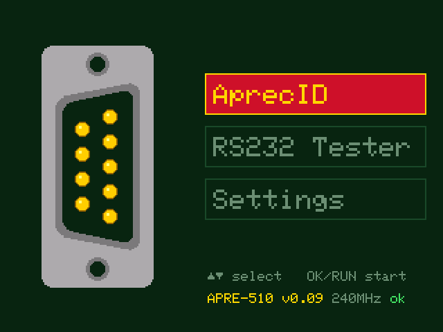
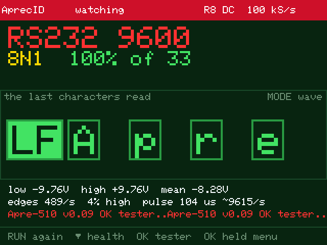

# AprecID and RS232 tester for the FNIRSI DSO-510

I wrote an alternative firmware that turns the FNIRSI DSO-510 into a pocket line identifier and
RS232/TTL serial tester, next to its oscilloscope and signal generator.

> **Use at your own risk.** This is a hobby project, not affiliated with FNIRSI, and there is no
> warranty of any kind. It is an alternative firmware: it is installed through the FNIRSI update,
> and a mistake there is yours to put right.

Touch a wire with the probe and **AprecID** tells what it is: GND, a supply rail, an RS232 or TTL
serial line with its speed and frame, Modbus RTU, RS485, CAN, I2C, LIN, PWM. A serial line is read
**directly through the oscilloscope input**, without a USART or a MAX3232. The **RS232 Tester**
then shows the waveform with the characters under the bits they were read from, the line's
electrical health, and the data in hex and ASCII.

APRE-510 runs **next to the FNIRSI firmware**, which stays as it is. Held at power-on, RUN starts
APRE-510. Without it, the unit starts the FNIRSI firmware as before.

 

More pictures in [`docs/screens`](docs/screens).

> **Note:** this is [T232USB](https://github.com/zeromem0/dso152-tester232-usb) for the DSO-152 and
> [dst210-tester232u](https://github.com/zeromem0/dst210-tester232u) for the DST-210, carried over
> to the DSO-510. Its beginnings go back to David's
> [dso152-breakout](https://github.com/davidgiven/dso152-breakout).

## What it does

- **AprecID** (first in the menu): what is on the probe.
  - Steady levels: GND, 3.3V, 5V, 12V, 24V, RS232 at rest.
  - Serial lines: RS232 or TTL, 1200 to 115200 baud, the frame (7 or 8 data bits, parity, stop
    bits), how many frames fitted, and the text read. The last five characters in boxes (CR and LF
    in green), or the waveform.
  - Modbus RTU, RS485 (A and B wires), CAN (H and L), I2C (SCL), LIN, PWM, each with details on
    AUTO.
  - **Hands-off** (Settings): the line is watched and recognised again when it changes, with a
    beep at each result.
- **RS232 Tester:**
  - RS232 or TTL levels.
  - 9600 8N1, 19200 8N1, or speed and frame worked out from the line, up to 115200 baud. Worked
    out from the line, the sample rate follows the speed by itself.
  - Views:
    - protocol: the waveform with the decoded characters under it;
    - single character: one frame drawn bit by bit, with the levels, the threshold and where each
      bit was read;
    - bus health: levels, bit rate, rise and fall times and jitter against the EIA-232 limits;
    - large: the last characters in big type;
    - hex;
    - characters.
  - **SNAP** waits for the first start bit and keeps the message, so that the first exchange on a
    line can be looked at.
- **Settings**, kept in flash: colour theme (ten of them, Halloween and Xmas among them), auto off
  (off, 10 or 30 minutes), hands-off, what it starts on (AprecID, the menu, or a demo on made-up
  lines), and erasing the tester's buffer.
- **USB:** the instrument's own USB socket is a serial port (USB CDC). The results go to the
  [apre page](https://zeromem0.github.io/apre/) in a browser, or to the apre Android app.

Zero volts on each range comes from the unit's own FNIRSI calibration. The tester reads it from
flash and never writes there, except its own settings page at the very end of the flash.

## Connecting

- **Probe tip** on the line (TX or RX), **probe ground** on its signal ground. Probe switch on
  ×1.
- AprecID chooses the range itself. In the tester, R8 (5 V a division) suits RS232 levels and
  R5–R6 suit TTL; the wheel (◄ ►) changes it.

## Buttons

All the buttons on one printable page: [`docs/buttons.html`](docs/buttons.html)
([view it rendered](https://htmlpreview.github.io/?https://github.com/zeromem0/apre-510/blob/main/docs/buttons.html)).
OK is the wheel pressed; ◄ ► are the wheel turned.

| Button | Press | What it does |
|---|---|---|
| RUN + POWER | at power-on | Starts APRE-510. POWER alone starts the FNIRSI firmware. |
| POWER | held 2 s | Switches the unit off, from anywhere in APRE-510 |
| OK | held | Back to the menu, from AprecID and from the tester |
| ▲ ▼, OK or RUN | short | Menu: AprecID, RS232 Tester, Settings |
| AUTO | held | Menu: About |

In **AprecID**: RUN looks again; MODE switches the characters in boxes and the waveform; AUTO
shows the details, where there are any; ▼ opens bus health and OK the tester, on the line just
found.

In the **RS232 Tester**:

| Button | Press | What it does |
|---|---|---|
| RUN | short | `RUN` → `HOLD` → capture (`WAIT`, then `SNAP`); in `WAIT`, back to `RUN` |
| MODE | short | View: protocol → single character → bus health → large → hex → characters; opened from AprecID, after the last view back to AprecID |
| MODE | held | In `WAIT` only: a simulated message, received as if from the line |
| ◄ ► | short | Range down / up |
| ▲ ▼ | short | Sample rate up / down: 100 k, 250 k, 500 k, 1.25 M, 2 M samples/s |
| AUTO | short | Speed: 9600 8N1 → 19200 8N1 → worked out from the line (`A` in the bar) |
| OK | short | RS232 ↔ TTL |
| POWER | short | Learn the speed and the frame again |

In **Settings**, ▲ ▼ choose the row and ◄ ► change the value; OK, RUN or MODE save and return to
the menu. On the Buffer row, AUTO held erases the buffer.

## Making the update file

The FNIRSI firmware is not part of this repository and may not be passed around: everyone takes
it from FNIRSI. `tools/make_update.py` puts it together with the tester into one file for the
FNIRSI USB update. It needs Python 3; nothing else.

> **The FNIRSI version.** APRE-510 was made and tried with **V2.2.1**, the version the DSO-510
> comes with now. FNIRSI has not yet put V2.2.1 on its website (only up to V2.0.5). Do not put
> V2.0.5 on a unit that came with V2.2.1: owners who did report a trace stuck at the top of the
> screen and AUTO no longer working. Until FNIRSI publishes the V2.2.1 file, there is no file to
> make the update from.

With the V2.2.1 application from FNIRSI (the `.zip`, or the `APP_*.bin` in it):

```
python tools/make_update.py DSO-510_V2.2.1.zip bin/APRE-510_v0.11.bin
```

or, after a build of your own (see below), with that build:

```
python tools/make_update.py DSO-510_V2.2.1.zip
```

The result is in `update/`, under the same name as the FNIRSI file. Of the FNIRSI application only
one word changes: the address through which its start-up code jumps to its main program now
points to the tester. The tester checks RUN, then goes on to the FNIRSI program, or starts itself.
It is placed after the FNIRSI application, from `0x08086000`, and checks its own CRC at start
("ok" in its menu).

The script finds that jump in any version, checks the file, and tells whether the version is one
the tester has been tried with. If an FNIRSI application reaches past `0x08086000`, it stops and
gives the new address: set it in `platformio.ini` (`board_build.flash_offset` and
`board_upload.offset_address`), build again, and run the script again. A version that has not been
tried is at your own risk.

## Installing through the FNIRSI update

1. Switch the unit off and connect it to a Windows 10/11 PC with a USB **data** cable.
2. **Hold OK (the wheel pressed) and switch it on.** A USB drive named *DSO-510* appears, with
   `Ready.TXT` on it.
3. Copy the update file onto that drive. The unit writes it and restarts by itself into the FNIRSI
   firmware.
4. **Hold RUN and switch it on:** APRE-510. Switched on normally, the unit starts the FNIRSI
   firmware.

**Going back:** the same steps with the FNIRSI file as it came. The FNIRSI bootloader and its
settings page with the calibration are never written by APRE-510 or by the update file.

## Building

You need [PlatformIO](https://platformio.org/): the VS Code extension, or the command line
(`pip install platformio`). The platform (`ststm32@19.0.0`) and the library (Adafruit GFX 1.12.6)
are pinned in `platformio.ini` and are downloaded on the first build.

```
git clone https://github.com/zeromem0/apre-510.git
cd apre-510
pio run
```

The result is `.pio/build/flash_apre/firmware.bin`, the tester alone, linked at `0x08086000`;
`tools/make_update.py` uses it by default. It cannot be uploaded with a debugger: the unit's flash
is read-protected, and the only way in is the FNIRSI update.

## Notes on the hardware

- **Processor:** the DSO-510 uses an Artery AT32F403A (1 MB flash, Cortex-M4). The build treats it
  as an STM32F103VE. The parts that differ are set by register in `src/hw/Probe.cpp`: the clock
  (240 MHz from the 8 MHz crystal) and the USB clock (from the internal 48 MHz oscillator, as in
  the FNIRSI firmware). The power is held on PD3.
- **Screen:** an ST7789V on the external memory bus (`src/hw/Lcd.cpp`).
- **Converter:** 8 bits read from GPIOB by DMA, clocked by a timer (`src/app/Acquire.cpp`).
- **Front end:** a relay, a 74HC4051 and a PWM offset, switched as the FNIRSI firmware does
  (`src/app/Frontend.cpp`).
- **Keys:** AUTO PD13, MODE PC6, ▲ PC7, ▼ PC8, RUN PC9, the wheel PB13 / PB14 (OK) / PB15, power
  PD2 (`src/app/Keys.h`).

Real RS232 lines have been recognised at 1200 through 115200 baud, 8N1, 8E1 and 8O1, and Modbus
RTU at 9600 8E1, with the verdict over USB in under 4 seconds.
